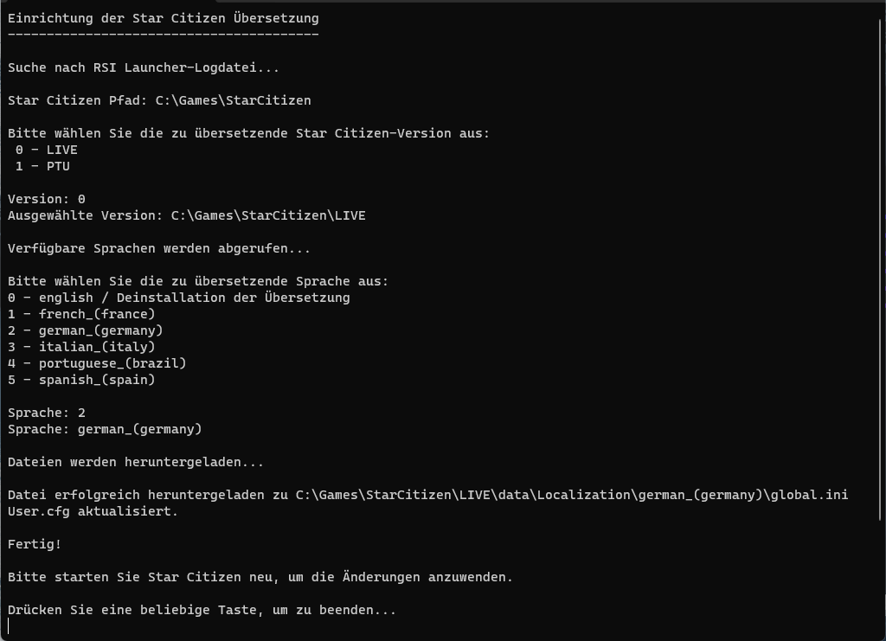

## SC-TranslationSetup 도구

- 🇬🇧 [Instructions in English.](README.md).
- 🇫🇷 [Instruction en Français](README_fr.md).
- 🇩🇪 [Anleitung auf Deutsch](README_de.md).
- 🇪🇸 [Instrucciones en Español](README_es.md).
- 🇮🇹 [Istruzioni in Italiano](README_it.md).
- 🇧🇷 [Instrução em Português](README_pt-BR.md).
- 🇹🇷 [Türkçe talimatlar](README_tr.md).
- 🇰🇷 [한국어 안내](README_ko-KR.md).

`SC-TranslationSetup` 저장소에 오신 것을 환영합니다. 이 도구는 [StarCitizen-Localization](https://github.com/Dymerz/StarCitizen-Localization) 저장소의 번역을 사용하여 Star Citizen의 번역 파일을 간편하게 설치할 수 있도록 도와줍니다.

# 독일어 실행 예시

### 주요 기능

- **간편한 설치:** Star Citizen 번역 파일의 설치 과정을 간소화합니다.
- **Star Citizen 설치 경로 자동 검색:** 게임 설치 경로를 찾고 번역을 설치할 버전(LIVE/PTU 등)을 선택할 수 있습니다.
- **다국어 지원:** StarCitizen-Localization 저장소에서 제공하는 언어의 번역 파일을 다운로드할 수 있으며, 프로그램 자체도 여러 언어를 지원합니다.
- **한국어 인터페이스:** Windows 표시 언어가 한국어(대한민국, `ko-KR`)이면 프로그램이 자동으로 한국어로 표시됩니다.
- **사용하기 쉬운 인터페이스:** 간단한 메뉴로 설치를 진행할 수 있습니다.
- **최신 번역 다운로드:** 실행할 때마다 StarCitizen-Localization 저장소에서 최신 번역을 가져옵니다.

### 추가 커뮤니티 소스

이 프로그램의 기본 번역 저장소는 [Dymerz/StarCitizen-Localization](https://github.com/Dymerz/StarCitizen-Localization)입니다.

다음과 같은 커뮤니티 관리 번역 소스도 포함되어 있습니다:

- [`MrKraken/StarStrings`](https://github.com/MrKraken/StarStrings) - 커뮤니티 수정 사항이 포함된 비공식 영어 버전입니다.
- [`ExoAE/ScCompLangPack`](https://github.com/ExoAE/ScCompLangPack) - 커뮤니티 수정 사항이 포함된 비공식 영어 버전입니다.
- [`rjcncpt/StarCitizen-Deutsch-INI`](https://github.com/rjcncpt/StarCitizen-Deutsch-INI) - 커뮤니티에서 제공하는 독일어 및 스위스 독일어 옵션입니다.

각 추가 저장소의 소유자는 프로그램의 언어 선택 메뉴에 표시됩니다.

[`rjcncpt/StarCitizen-Deutsch-INI`](https://github.com/rjcncpt/StarCitizen-Deutsch-INI) 저장소는 일부 콘텐츠가 CC-BY-NC-SA-4.0 라이선스로 제공된다고 명시하고 있습니다. 저작자 표시 및 재사용 조건은 해당 저장소를 확인하세요.

### 다운로드

SC-TranslationSetup 도구의 최신 버전을 다운로드하세요:

🔗 [SC-TranslationSetup.exe 다운로드](https://github.com/ROBdk97/SC-TranslationSetup/releases/latest/download/SC-TranslationSetup.exe)

### 설치

1. **도구 다운로드:** 위 링크를 클릭하여 `SC-TranslationSetup.exe`를 다운로드합니다.
2. **프로그램 실행:** 다운로드한 파일을 두 번 클릭하여 실행합니다.

### 사용 방법

1. `SC-TranslationSetup.exe`를 실행합니다.
2. Star Citizen 설치 경로가 자동으로 검색되지 않으면 직접 입력합니다.
3. 번역을 설치할 게임 버전(LIVE/PTU 등)을 선택합니다.
4. 방향키로 `korean_(south_korea)` 항목을 선택하고 Enter 키를 누릅니다.
5. 설치가 완료되면 Star Citizen을 다시 시작하여 번역을 적용합니다.

영어로 되돌리려면 도구를 다시 실행하고 언어 선택 메뉴에서 번역 제거 항목을 선택한 뒤 확인하세요. 설치된 번역 파일이 삭제됩니다.

### 지원

문제나 질문이 있으면 이 저장소에 이슈를 등록하거나 [StarCitizen-Localization](https://github.com/Dymerz/StarCitizen-Localization) 저장소를 통해 문의하세요.

### 기여

기여는 언제나 환영합니다! 번역 파일 기여에 관한 안내는 [StarCitizen-Localization](https://github.com/Dymerz/StarCitizen-Localization) 저장소를 확인하세요.

### 라이선스

자세한 내용은 [LICENSE](LICENSE.txt)를 확인하세요.

---

한국어로 Star Citizen을 즐겨보세요!

---
## 면책 조항

> [!IMPORTANT]
> **커뮤니티 제작 프로젝트** - 이 프로젝트는 Cloud Imperium 기업 그룹과 관련이 없는 비공식 Star Citizen 팬 프로젝트입니다. 이 저장소의 소유자 또는 사용자가 작성하지 않은 모든 콘텐츠의 권리는 해당 소유자에게 있습니다.
>
> - 추출한 `global.ini` 파일로 게임의 번역을 사용자 지정하는 기능은 공식 번역이 통합될 때까지 커뮤니티 번역을 지원하기 위해 CIG가 의도하고 허용한 기능입니다.
>   - *[Star Citizen: Community Localization Update](https://robertsspaceindustries.com/spectrum/community/SC/forum/1/thread/star-citizen-community-localization-update) 2023-10-11*
> - 제3자 기여물이므로 사용 여부는 본인의 판단에 따릅니다.
> - [RSI 서비스 약관](https://robertsspaceindustries.com/tos)
> - [번역 및 팬 현지화 관련 안내](https://support.robertsspaceindustries.com/hc/en-us/articles/360006895793-Star-Citizen-Fankit-and-Fandom-FAQ#h_01JNKSPM7MRSB1WNBW6FGD2H98)

Star Citizen®, Roberts Space Industries® 및 Cloud Imperium®은 Cloud Imperium Rights LLC의 등록 상표입니다.
